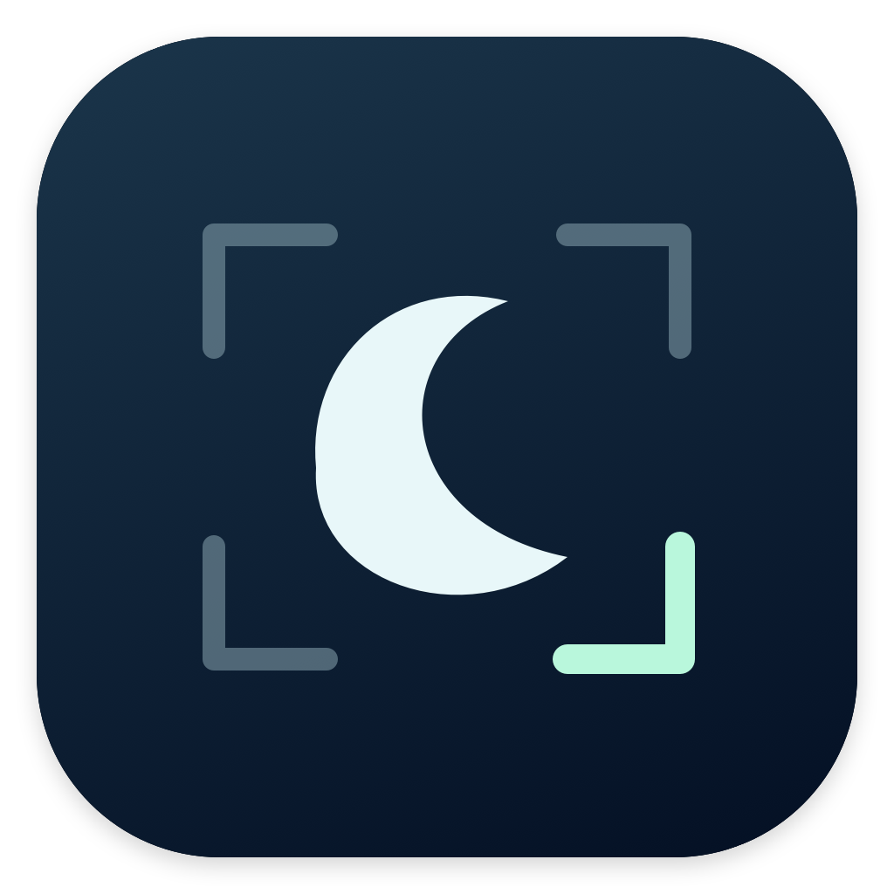
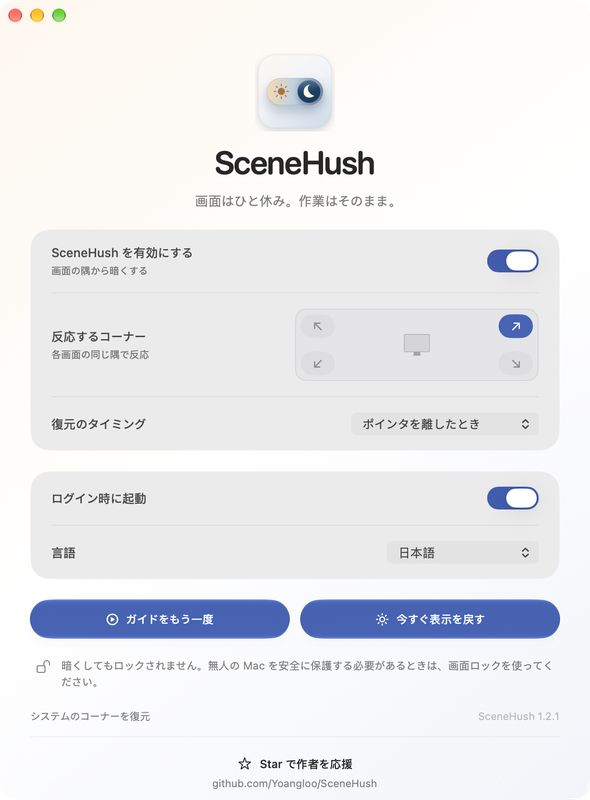
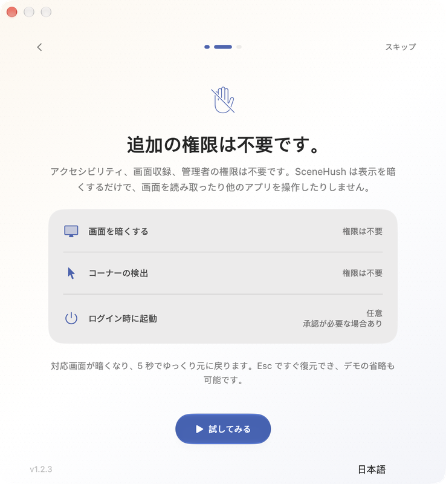

# SceneHush

[English](../README.md) · [简体中文](README.zh-CN.md) · [日本語](README.ja.md)

**画面はひと休み。作業はそのまま。**

SceneHush は単独で動作する、小さな macOS メニューバーアプリです。選んだ隅にポインタを移動すると、接続中の対応ディスプレイが暗くなり、離すと元の表示に戻ります。**バージョン 1.2 は macOS 標準の表示制御だけを使い、追加アプリを必要としません。**



## このツールを作った理由

最初の要望は、外部モニターを接続した MacBook で、一つの隅から両方の画面をまとめて暗くしたい、というものでした。SceneHush はその操作から、コンピューター上のエージェントが作業している間に短く離席するためのツールへと育ちました。隅を選び、少し離れて、同じデスクトップセッションに戻れます。

SceneHush は画面出力を調整し、デスクトップ上に黒いウインドウを重ねません。エージェントへ一時停止の指示を送ったり、アプリを閉じたり、ログアウトしたりしません。一部のデスクトップ操作は、ロックされていないセッションやフォアグラウンド操作を必要とし、独立して動作するエージェントもあります。キャプチャーとエージェントの互換性は利用環境で確認してください。

Mac のスリープや自動ロックを防がず、エージェントの動作継続やタスクの完了を保証しません。認証機能もないため、他の人が画面を戻し、ロックされていない Mac を操作できます。公共・共有の場所や、安全に無人のコンピューターを保護する必要がある場合は、macOS の画面ロックを使用してください。

## 機能

- 四隅から選択でき、接続中のどの画面でも、選んだ隅で操作できます。
- CoreGraphics の標準制御で、対応する内蔵画面と外部ディスプレイの出力をまとめて暗くします。
- ポインタを離して復元、または暗い状態を維持して次のコーナー操作で復元できます。
- 初回ガイドで権限を説明し、任意で 5 秒間の暗転・復元デモを体験できます。
- ガイドの再表示、一時停止、即時復元をメニューバーから行えます。
- システム言語、English、简体中文、日本語を、再起動なしで切り替えられます。
- 中央揃えの設定画面と昼夜スイッチのアイコン。macOS 26 以降では Liquid Glass、以前のシステムでは標準の互換コントロールを使います。
- ログイン時の起動を任意で有効にできます。
- 調整前の表示状態を Mac 内に保存し、異常終了時に監視プロセスが復元を試みます。
- 競合する macOS ホットコーナーの置き換えを選べ、元の設定を保存して復元できます。

## インストールと初回ガイド

1. [Releases](https://github.com/Yoangloo/SceneHush/releases/latest) から DMG または ZIP をダウンロードします。
2. **SceneHush.app** を**アプリケーション**にドラッグして開きます。ZIP は先に展開してください。
3. ガイドで表示の変化と権限について確認します。準備ができたら 5 秒間のデモを開始するか、スキップできます。
4. 接続中の対応画面が暗くなり、5 秒かけて保存した表示状態へ戻ります。**Escape** キーで直ちに復元できます。ガイドの表示中はコーナー操作が一時停止します。
5. ガイドを完了すると設定が開きます。隅を選び、ポインタを移動して試してください。

メニューバーにはアイコンだけを表示し、開いたメニューに SceneHush の名前が表示されます。Dock アイコンはありません。ガイドは後から再表示できます。

このリリースは **ad-hoc 署名のみで、Developer ID 署名と Apple の公証はありません**。macOS にブロックされた場合は、配布元を信頼できることを確認してから、**システム設定 → プライバシーとセキュリティ → このまま開く**を選択してください。ソースからビルドすることもできます。チェックサムはファイルの一致を確認するもので、公証の代わりではありません。

## 必要な権限



標準の表示制御とコーナー検出に、**アクセシビリティ、画面収録、管理者の権限は不要**です。SceneHush は画面をキャプチャーせず、他のアプリも操作しません。ガイドではその違いを説明し、使わない権限を要求しません。

**ログイン時の起動は任意です。** 有効にすると、macOS のログイン項目で承認が必要になる場合があります。競合するホットコーナーの変更もアプリ内で利用者が選び、元の設定を保存します。

## 動作環境と互換性

- **macOS 13 Ventura 以降**。Apple Silicon と Intel の Mac に対応。
- macOS のガンマ制御に対応したディスプレイとドライバー。追加の表示ユーティリティは不要です。

SceneHush は RGB ガンマ出力を調整します。ハードウェアの輝度スライダーを 0% に設定したり、バックライトを消したり、電源を切ったりする機能ではありません。HDR、仮想ディスプレイ、一部のドライバーは非対応の場合や、設定を上書きする場合があります。失敗が報告されると復元を試みてエラーを表示し、代わりに黒いウインドウを追加することはありません。

調整前の表示状態は変更を適用する前に保存します。ガイドのデモ中を含め、アプリが異常終了すると監視プロセスが復元を試みます。復元は保証ではなく、切断中や応答のない画面では再接続が必要になる場合があります。

他のアプリを通じて輝度を操作する旧版から更新する場合は、画面を復元して旧版を終了してから置き換えてください。隅、復元方法、言語の設定は維持し、以前の調光方式の選択は無視します。古い輝度ファイルは削除せず、ガンマデータとして扱いません。未復元のファイルがある場合は新しい調整を停止するため、先に旧版で復元してください。

## 使い方

メニューバーのアイコンから、設定、隅と復元方法、言語、一時停止、即時復元を操作できます。初期設定は**右下**で、**ポインタを離すと復元**します。

選んだ隅に macOS の操作がある場合、SceneHush は任意で置き換えを提案します。元の値を Mac 内に保存し、設定から復元できます。macOS 側でホットコーナーを変更することもできます。

使用をやめるときは、画面を復元してから終了してください。アンインストール前にログイン時の起動を無効にし、置き換えたホットコーナーを元に戻してください。

## プライバシー

解析、広告、テレメトリー、バックグラウンド通信はありません。ディスプレイ識別子、設定、復元データは Mac 内の `~/Library/Application Support/SceneHush/` に保存します。利用者がプロジェクトのリンクを選んだ場合のみ Web サイトを開きます。

## ソースからビルド

開発には **macOS 14 以降**、**Swift 6 ツールチェーン**、Xcode 26 または対応する Command Line Tools の **macOS 26 SDK** が必要です。新しい SDK は Liquid Glass API を提供し、配布アプリはバージョン確認により macOS 13 以降に対応します。テストは Swift Testing を使い、`make test` は選択中の開発ツールに合わせて動作します。

```sh
git clone https://github.com/Yoangloo/SceneHush.git
cd SceneHush
make test
make build
make package
```

アプリは `build/SceneHush.app`、DMG・ZIP・SHA-256 チェックサムは `dist/` に生成します。配布版には **arm64 と x86_64** を含みます。Apple Silicon での高速なローカルビルドには `make build ARCH=arm64` を使えます。開発チェックは [CONTRIBUTING.md](../CONTRIBUTING.md)、測定結果と未検証環境は[検証記録](VALIDATION.md)を参照してください。

## フィードバックとライセンス

SceneHush が役に立ったら、[GitHub で Star](https://github.com/Yoangloo/SceneHush) を付けて作者を応援してください。設定画面の一番下にもリポジトリのアドレスがあります。

不具合や提案は [Issues](https://github.com/Yoangloo/SceneHush/issues) にお寄せください。SceneHush と macOS のバージョン、Mac のアーキテクチャ、画面の接続、HDR・仮想画面の設定、再現手順を記載し、ログや画像から個人情報を除いてください。[SECURITY.md](../SECURITY.md) と [CHANGELOG.md](../CHANGELOG.md) も参照してください。

SceneHush は [MIT ライセンス](../LICENSE) を採用しています。理由は[ライセンス選定メモ](LICENSING.md)に記載しています。
