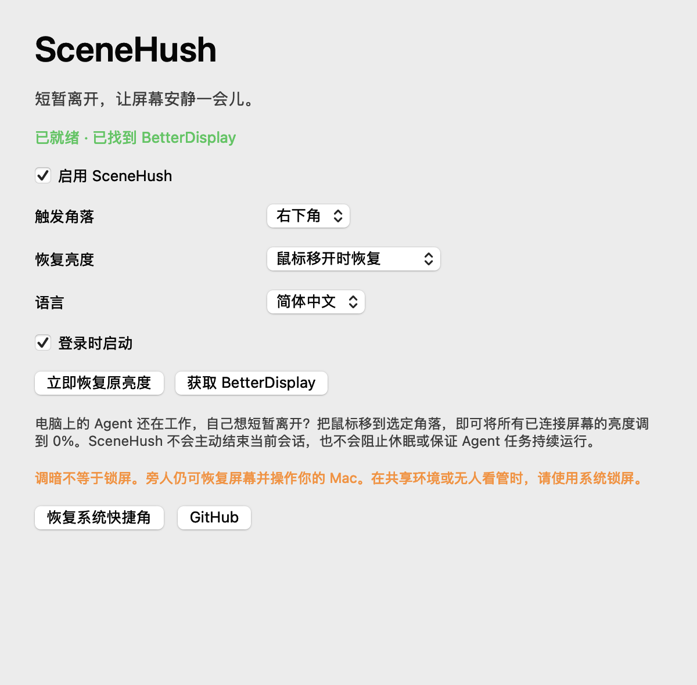

# SceneHush

[English](../README.md) · [简体中文](README.zh-CN.md) · [日本語](README.ja.md)

**把屏幕的安静，放在一个角落。**

SceneHush 是一个轻量 macOS 菜单栏 App。将鼠标移到选定的屏幕角落，即可通过 BetterDisplay 将所有已连接且支持控制的显示屏亮度降到 **0%**。默认移开鼠标后，各屏恢复到各自原来的亮度。



## 为什么做这个工具

项目起于一个具体需求：MacBook 同时连接外接显示器时，希望把鼠标移到右下角，就能用电脑上已有的 BetterDisplay 将**两块屏幕一起调到 0**。最初的右下角动作，后来扩展成了 SceneHush：有独立名称的菜单栏 App，可以选择四个角、保存配置，并切换三种界面语言。

它面向这样一个场景：电脑上的 agent 正在工作，人想短暂离开，让屏幕暗下来。一些 agent 流程依赖可见桌面、未锁定的用户会话或前台交互；锁屏、睡眠或交互暂停，可能打断其中的步骤。另一些 agent 可以独立运行。SceneHush 提供的是另一个选择：只调整屏幕亮度，让当前桌面会话保持原样。

它不会阻止电脑睡眠或自动锁屏，也不保证 agent 持续运行或完成任务。它同样没有身份验证：旁人可以恢复亮度，继续操作这台未锁定的 Mac。公共、共享环境，或需要安全地无人看管电脑时，请使用 macOS 系统锁屏。

## 功能

- 四个角任选，所选角落在每块已连接的屏幕上都能触发。
- 同时调暗 MacBook 内置屏和外接显示屏。
- 默认移开鼠标恢复；也可选择保持调暗，再次进入角落时恢复。
- 在菜单栏中随时启用或暂停。
- 界面支持跟随系统、English、简体中文和日本語，切换后立即生效。
- 可选登录时自动启动。
- 调暗前在本机保存原亮度，异常退出后可恢复。
- 可选择替换有冲突的 macOS 快捷角，并备份原设置，供手动还原。

SceneHush 只调整亮度，**不会锁定 macOS**。BetterDisplay 的 0% 表示当前配置允许的最低亮度，不保证显示屏背光关闭或断电。暗屏不构成隐私或安全边界。

## 使用要求

- **macOS 13 Ventura 或更新版本**，支持 Apple Silicon 和 Intel Mac。
- 已安装并运行 [BetterDisplay](https://github.com/waydabber/BetterDisplay)。
- 已在 BetterDisplay 的集成设置中启用**命令行集成**。

SceneHush 使用 BetterDisplay 已有的显示器控制能力。外接屏能否受控，取决于显示器、连接方式和 BetterDisplay 配置。BetterDisplay 是独立产品，不包含在 SceneHush 安装包内。

## 安装

1. 从 [Releases](https://github.com/Yoangloo/SceneHush/releases/latest) 下载 DMG 或 ZIP。
2. 打开 DMG，将 **SceneHush.app** 拖到**应用程序**；如果下载 ZIP，解压后将 App 移到应用程序文件夹。
3. 打开 SceneHush。名称和图标会出现在顶部菜单栏，无需 Dock 图标。
4. 确认 BetterDisplay 正在运行，且已开启命令行集成。
5. 打开 SceneHush 菜单，选择触发角落，再将鼠标移到该角落试用。

首个版本使用 **ad-hoc 签名，尚无 Developer ID 签名及 Apple 公证**。如果 macOS 阻止打开，请先确认你信任本仓库和下载的 Release，再到**系统设置 → 隐私与安全性 → 仍要打开**。也可以从源码自行构建。下载校验和用于确认文件一致性，不能替代 Apple 公证。

## 使用

点击菜单栏的 **SceneHush**，即可选择触发角落、调整恢复方式、切换语言、暂停触发或立即恢复亮度。默认使用**右下角**，恢复方式为**移开鼠标后恢复**。

如果所选角落已有 macOS 快捷角动作，SceneHush 会提供替换选项，由你选择是否替换。原设置会保存在本机，并可通过 SceneHush 设置中的还原操作恢复；也可以自行在 macOS 设置中调整快捷角。

需要开机后继续使用时，可启用登录自动启动。停用前先恢复亮度并退出；卸载前关闭登录自动启动。如果曾替换系统快捷角，请先还原，再移除 App。

## 隐私

SceneHush 不含分析、广告、遥测或后台网络请求。显示屏标识、配置和亮度恢复数据只保存在本机的 `~/Library/Application Support/SceneHush/`。只有主动点击项目或 BetterDisplay 链接时，才会打开对应网站。

## 从源码构建

开发环境需要 **macOS 14 或更新版本**及 **Swift 6 工具链**，包含 Xcode 或 Xcode Command Line Tools 提供的 macOS SDK。测试使用 Swift Testing；`make test` 会运行项目测试脚本，自动适配当前选中的 Xcode 或 Command Line Tools 安装。这些是开发环境要求，打包后的 App 仍支持 **macOS 13 或更新版本**。

```sh
git clone https://github.com/Yoangloo/SceneHush.git
cd SceneHush
make test
make build
make package
```

App 生成在 `build/SceneHush.app`；DMG、ZIP 和 SHA-256 校验文件生成在 `dist/`。默认发布版本为同时支持 **arm64 和 x86_64** 的通用二进制。在 Apple Silicon 上快速本地构建可使用 `make build ARCH=arm64`；公开发布使用默认通用版本。开发与验证说明见 [CONTRIBUTING.md](../CONTRIBUTING.md)。

## 反馈与贡献

欢迎通过 [Issues](https://github.com/Yoangloo/SceneHush/issues) 提交问题和建议。请提供 macOS 版本、Mac 架构、BetterDisplay 版本、显示器连接情况及复现步骤。安全问题参见 [SECURITY.md](../SECURITY.md)，更新内容参见 [CHANGELOG.md](../CHANGELOG.md)。

## 开源协议

SceneHush 使用 [MIT 协议](../LICENSE)。BetterDisplay 仍受其自身协议约束。[协议选择说明](LICENSING.md) 记录了本项目的选择理由。
