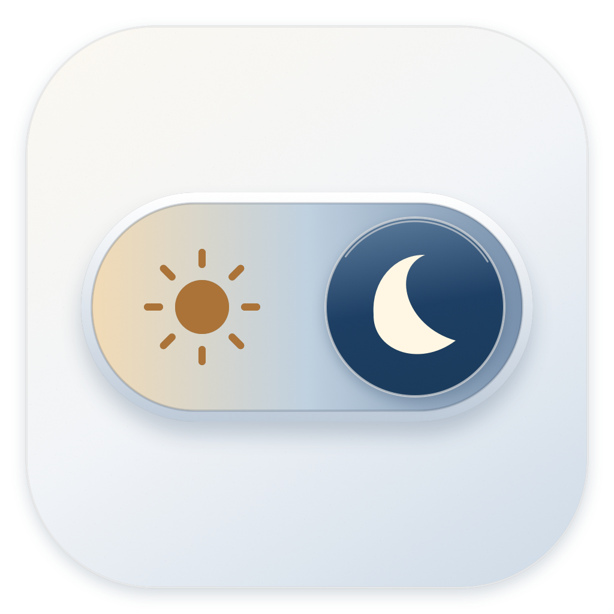
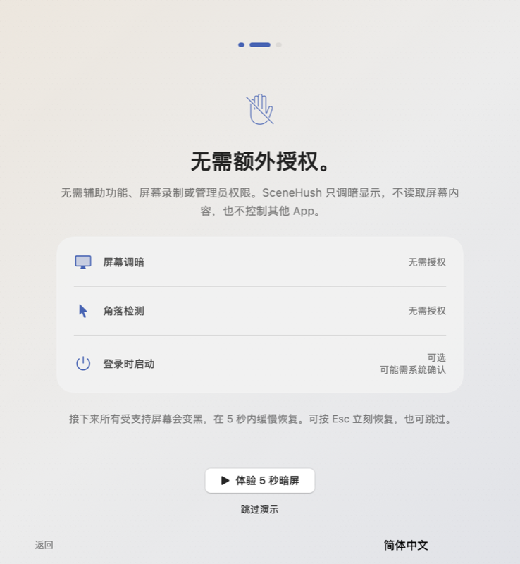

# SceneHush

[English](../README.md) · [简体中文](README.zh-CN.md) · [日本語](README.ja.md)

**屏幕歇一会，工作继续。**

SceneHush 是一个可独立运行的轻量 macOS 菜单栏 App。将鼠标移到选定角落，让已连接且受支持的屏幕暗下来；默认移开后，恢复各屏原来的显示状态。**1.2 版只使用 macOS 原生显示控制，无需配套 App。**


## 为什么做这个工具

最初的需求很简单：MacBook 同时连接外接显示器时，希望一个角落就能让两块屏幕一起暗下来。SceneHush 从这个动作，成为面向电脑 agent 工作期间短暂离席的小工具。选一个角落，短暂离开，再回到原来的桌面会话。

SceneHush 调整显示输出，不在桌面上盖黑色窗口；不会向 agent 发送暂停指令、关闭它们的 App 或退出登录。一些桌面流程依赖未锁定的会话或前台交互，另一些 agent 可以独立运行。截图表现和 agent 兼容性仍需在自己的环境中验证。

它不会阻止休眠或自动锁屏，也不保证 agent 持续运行或完成任务。它没有身份验证：旁人可以恢复显示，操作这台未锁定的 Mac。公共、共享环境，或需要安全地无人看管电脑时，请使用 macOS 系统锁屏。

## 功能

- 四个角任选，所选角落在每块已连接的屏幕上都能触发。
- 通过原生 CoreGraphics 控制，同时调暗受支持的内置屏和外接屏输出。
- 移开鼠标恢复，或保持暗屏、再次进入角落时恢复。
- 首次引导解释权限，并提供可选的 5 秒暗屏渐亮演示。
- 随时重看引导，在菜单栏暂停触发或立即恢复显示。
- 跟随系统、English、简体中文和日本語，即切即生效。
- 居中排版、日夜开关图标，macOS 26 及更新系统使用液态玻璃控件；较早系统使用原生兼容控件。
- 可选登录自动启动。
- 调暗前在本机保存显示状态；主程序异常退出后，由监护进程尝试恢复。
- 可选择替换有冲突的 macOS 快捷角，备份原设置并手动还原。

## 安装与首次使用

1. 从 [Releases](https://github.com/Yoangloo/SceneHush/releases/latest) 下载 DMG 或 ZIP。
2. 将 **SceneHush.app** 拖到**应用程序**后打开；ZIP 请先解压。
3. 引导会说明显示变化和权限需求。准备好后再体验 5 秒演示，也可以跳过。
4. 演示让已连接且受支持的屏幕变黑，再用 5 秒逐渐恢复原来的显示状态。按 **Escape** 可立即恢复；引导打开时暂停角落触发。
5. 完成引导进入设置，选择触发角落，再将鼠标移入试用。

顶部菜单栏仅显示图标，点开后可看到 SceneHush 名称；Dock 中不显示图标。之后可以随时重新打开引导。

此版本使用 **ad-hoc 签名，尚无 Developer ID 签名及 Apple 公证**。如 macOS 阻止打开，请先确认信任本仓库和下载的 Release，再到**系统设置 → 隐私与安全性 → 仍要打开**。也可以从源码自行构建。校验和用于确认文件一致性，不能替代 Apple 公证。

## 需要哪些授权



原生显示控制和角落检测**无需辅助功能、屏幕录制或管理员授权**。SceneHush 不截取屏幕，也不控制其他 App。引导解释这些区别，不会索取未使用的权限。

**登录自动启动是可选项。** 开启后，macOS 可能要求在“登录项”中批准。替换有冲突的系统快捷角也由你在 App 内决定，原设置会保存供恢复。

## 使用要求与兼容性

- **macOS 13 Ventura 或更新版本**，支持 Apple Silicon 和 Intel Mac。
- 显示器及驱动需支持 macOS 伽马控制，无需其他显示器工具。

SceneHush 调整 RGB 伽马输出，**不会**将硬件亮度滑块设为 0%、关闭背光或让显示屏断电。HDR、虚拟显示屏及部分驱动可能不支持该控制，或会覆盖设置。系统报告失败时会尝试恢复并提示错误，不会改用桌面遮罩。

每次调暗前先保存显示状态。包括引导演示在内，主程序异常退出时，监护进程会尝试恢复。恢复并非绝对保证：断开或未响应的屏幕可能需要重新连接后才能还原。

从通过其他 App 控制亮度的旧版升级时，请先恢复显示并退出旧版，再替换 App。原有角落、恢复方式和语言偏好会保留，旧调暗方式选项会被忽略。旧亮度文件不会删除，也不会当作伽马数据处理；如仍有待恢复的旧文件，会先阻止新暗屏，请用旧版恢复后再继续。

## 使用

点击菜单栏图标，可以打开设置、选择角落和恢复方式、切换语言、暂停 SceneHush 或立即恢复显示。默认使用**右下角**，恢复方式为**移开鼠标后恢复**。

如果所选角落已有 macOS 快捷角动作，SceneHush 会提供替换选项。是否替换由你决定；原设置会备份到本机，可从设置中还原。也可以自行在 macOS 设置中调整快捷角。

停用前请恢复显示并退出。卸载前关闭登录启动，并还原曾被 SceneHush 替换的系统快捷角。

## 隐私

SceneHush 不含分析、广告、遥测或后台网络请求。显示屏标识、偏好和恢复数据只保存在本机的 `~/Library/Application Support/SceneHush/`。只有主动点击项目链接时才会打开网站。

## 从源码构建

开发需要 **macOS 14 或更新版本**、**Swift 6 工具链**和 **macOS 26 SDK**，可使用 Xcode 26 或对应的 Command Line Tools。新 SDK 提供液态玻璃 API，打包后的 App 通过版本检查仍支持 macOS 13 及更新系统。测试使用 Swift Testing，`make test` 自动适配当前选中的 Xcode 或 Command Line Tools。

```sh
git clone https://github.com/Yoangloo/SceneHush.git
cd SceneHush
make test
make build
make package
```

App 生成在 `build/SceneHush.app`；DMG、ZIP 和 SHA-256 校验文件生成在 `dist/`。发布版包含 **arm64 和 x86_64**；在 Apple Silicon 上快速本地构建可用 `make build ARCH=arm64`。开发检查见 [CONTRIBUTING.md](../CONTRIBUTING.md)，实测与未覆盖环境见[验证记录](VALIDATION.md)。

## 反馈与协议

欢迎通过 [Issues](https://github.com/Yoangloo/SceneHush/issues) 提交问题与建议。请提供 SceneHush、macOS 版本、Mac 架构、显示器连接方式、HDR 或虚拟屏设置及复现步骤，分享日志和截图前请移除隐私信息。另见 [SECURITY.md](../SECURITY.md) 和 [CHANGELOG.md](../CHANGELOG.md)。

SceneHush 使用 [MIT 协议](../LICENSE)，选择理由见[协议说明](LICENSING.md)。
